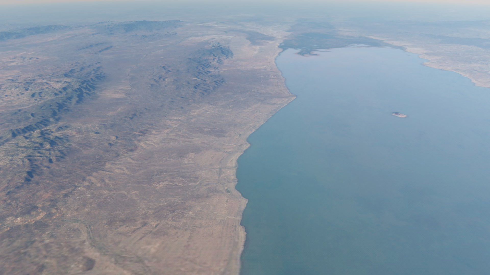
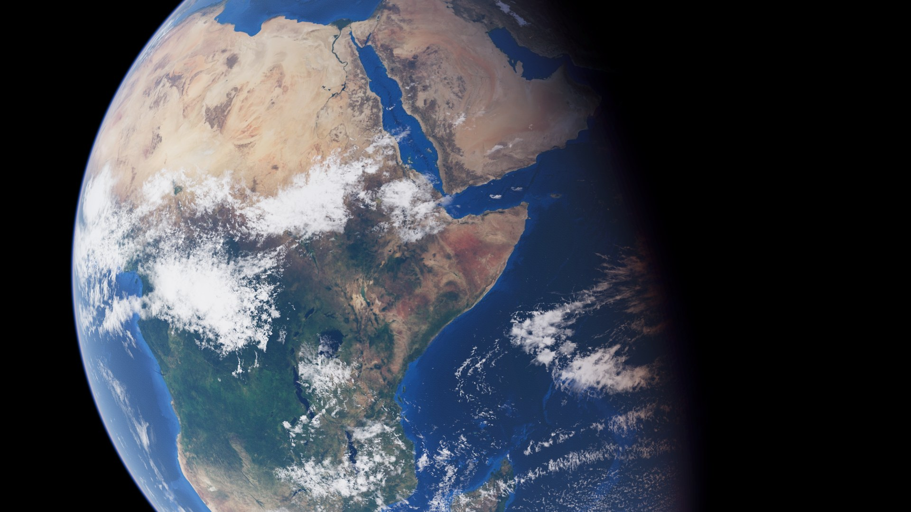

# Age of Earth (working title)

  
  

A real-time strategy game for Android in the classic town-building genre: gather food, stone and wood, build a camp, advance through the ages, train a band and beat computer opponents. Your people start at the very beginning, as early humans at an East African rift lake, and discover the cutting stone, fire and words to reach the next age.

**Download the Android APK:** https://github.com/Matswm86/mwm-age-of-earth/releases/download/latest/mwm-age-of-earth.apk

- No ads, no tracking, no accounts, no network, no in-app purchases. Asks for no Android permissions.
- Debug-signed sideload build (built by GitHub Actions on every push to `main`). If Android warns about the source, allow "Install from this source".

## What is in this build

An early playable build. The graphics are being rebuilt; the game screens below the opening are not final.

- **Opening:** about 75 seconds from a pale blue dot in space down to Lake Turkana in the East African rift, then into your camp. Tap to skip after the first viewing.
- **Age 1 start:** a band of 6 foragers at the Home Tree. Gather food, wood and stone, build a Nest Grove, Cache and Knapping Floor, train foragers and research "The Stone That Cuts". Hints show each next step.
- **Map:** real West Turkana terrain from Copernicus elevation data, with photo-scanned ground, trees, rocks and animals (credits in `CREDITS.md`).
- **Controls:** tap a unit, drag a selection box, tap the ground to move or gather, two fingers to pan, pinch to zoom. **Menu** holds the speed bench; a three-finger tap shows the frame rate.
- Not built yet: combat, the computer opponent, sound.

## Plan

Version 1: one people, the first three ages, one real-terrain rift-lake map, skirmish against one or two computer opponents at three honest difficulty levels. The rules are in `docs/GDD.md`, every balance number in `data/balance.json`, and `tools/balance_sim.py` checks the economy pacing.

## For developers

Godot 4.6.2, GDScript with static types, `mobile` renderer, landscape 1920x1080.

| Path | What |
|---|---|
| `scripts/SpikeConfig.gd` | Every spike number in one place |
| `scripts/Units.gd` | Unit simulation and the MultiMesh drawing |
| `scripts/FlowField.gd` | Flow-field pathfinding on a worker thread |
| `scripts/FogOfWar.gd` | Fog of war texture |
| `scripts/RtsCamera.gd` | Steep strategy camera, pan and zoom |
| `scripts/Bench.gd` | The four-run speed bench |
| `shaders/unit.gdshader` | Walk cycle, team colour, selection flag |

Checks: run the studio Android lint (`gd-android-lint.sh .`), a headless load with `--audio-driver Dummy --quit`, the screenshot bot `res://tests/capture.tscn` under Xvfb at 1920x1080, and `python3 tools/balance_sim.py`. Never build the APK locally; CI does it (`.github/workflows/build-android.yml`). Credits: `CREDITS.md`.

"Age of Earth" is a working title. This game is inspired by the real-time strategy genre and is not affiliated with any other game or publisher.
