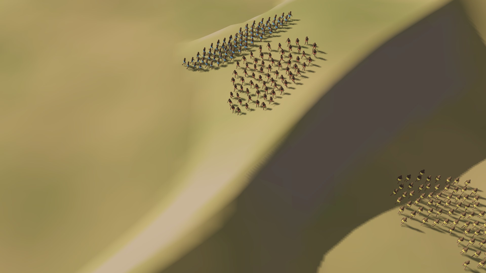

# Age of Earth (working title)

  

A real-time strategy game for Android in the classic town-building genre: gather food, stone and wood, build a camp, advance through the ages, train a band and beat computer opponents. Your people start at the very beginning, as early humans at an East African rift lake, and discover the cutting stone, fire and words to reach the next age.

**Download the Android APK:** https://github.com/Matswm86/mwm-age-of-earth/releases/download/latest/mwm-age-of-earth.apk

- No ads, no tracking, no accounts, no network, no in-app purchases. Asks for no Android permissions.
- Debug-signed sideload build (built by GitHub Actions on every push to `main`). If Android warns about the source, allow "Install from this source".

## What is in this build: the tech spike

This build is a speed test, not the game yet. It answers one question: can a phone move about 200 animated units at 60 fps? Everything on screen is placeholder art.

- 150, 165 or 210 units on a 512 x 512 m map with ridges and a lake. All units are drawn in one batch, with the walk cycle done in the shader instead of skeletons.
- Flow-field pathfinding on a 128 x 128 grid (4 m cells), built on a worker thread; units keep apart and walk around ridges and water.
- Fog of war (unexplored, explored, visible), updated 5 times a second.
- Touch: tap a unit, drag a selection box, tap the ground to move, two fingers to pan, pinch to zoom.
- **Bench all** runs 150, 165 and 210 units at normal speed and 210 at 1.5x speed for 20 s each, then shows average fps, 1% low fps and frame times. A three-finger tap hides or shows the readout.

How to test on a phone: install, leave Quality on High, tap **Bench all**, put the phone down for about 95 seconds and screenshot the results. The target is 60 fps with 210 units on a current phone, and 30 fps on Low quality on an older tablet.

## Plan

Version 1: one people, the first three ages, one real-terrain rift-lake map, skirmish against one or two computer opponents at three honest difficulty levels. The rules are in `docs/GDD.md`, every balance number in `data/balance.json`, and `tools/balance_sim.py` checks the economy pacing.

## For developers

Godot 4.6.2, GDScript with static types, `mobile` renderer, landscape 1920x1080.

| Path | What |
|---|---|
| `scripts/SpikeConfig.gd` | Every spike number in one place |
| `scripts/Units.gd` | Unit simulation and the MultiMesh drawing |
| `scripts/FlowField.gd` | Flow-field pathfinding on a worker thread |
| `scripts/FogOfWar.gd` | Fog of war texture |
| `scripts/RtsCamera.gd` | Steep strategy camera, pan and zoom |
| `scripts/Bench.gd` | The four-run speed bench |
| `shaders/unit.gdshader` | Walk cycle, team colour, selection flag |

Checks: run the studio Android lint (`gd-android-lint.sh .`), a headless load with `--audio-driver Dummy --quit`, the screenshot bot `res://tests/capture.tscn` under Xvfb at 1920x1080, and `python3 tools/balance_sim.py`. Never build the APK locally; CI does it (`.github/workflows/build-android.yml`). Credits: `CREDITS.md`.

"Age of Earth" is a working title. This game is inspired by the real-time strategy genre and is not affiliated with any other game or publisher.
